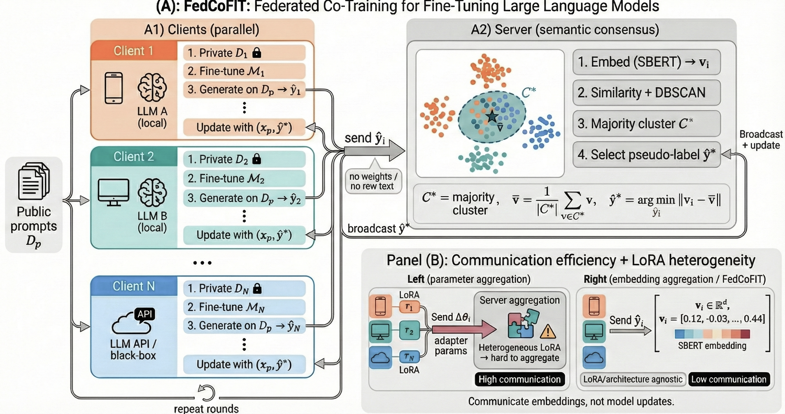

# FedCoFiT: Federated Co-training for Fine-tuning LLMs

**FedCoFiT** is a federated learning framework for instruction-following and classification tasks that uses **semantic consensus approach** proposed in **Beyond Parameter Aggregation: Semantic Consensus for Federated Fine-Tuning of LLM** to improve model performance across distributed clients.



## 🎯 Key Features

- **Semantic Consensus**: Uses DBSCAN clustering on sentence embeddings to find agreement across client predictions
- **Privacy-Preserving**: Client data never leaves local devices
- **Personalized Models**: Each client maintains its own adapted model
- **Flexible Configuration**: Single config file for all experiment settings
- **Multiple Benchmarks**: Supports IFEval, MMLU, and MT-Bench evaluation
- **Communication Efficient**: Clients send only text responses, server computes embeddings

## 📋 Table of Contents

- [Installation](#installation)
- [Quick Start](#quick-start)
- [Method Overview](#method-overview)
- [Code Structure](#code-structure)
- [Configuration Guide](#configuration-guide)
- [Running Experiments](#running-experiments)
- [Evaluation Benchmarks](#evaluation-benchmarks)
- [Results & Logging](#results--logging)

## 🔧 Installation

### Prerequisites

- Python 3.8+
- CUDA-capable GPU(s) with 24GB+ VRAM (for TinyLlama; more for larger models)
- 50GB+ disk space for models and datasets

### Setup

```bash
# Clone the repository
git clone https://github.com/your-username/FedCoFiT.git
cd FedCoFiT

# Create conda environment
conda create -n fedcofit python=3.10 -y
conda activate fedcofit

# Install dependencies
pip install -r requirements.txt

# (Optional) Install FlashAttention2 for faster training
pip install flash-attn --no-build-isolation
```

## 🚀 Quick Start

```bash
# Run with default configuration (TinyLlama + Dolly-15k)
python -m fedcofit.run --config configs/config.yaml

# Override parameters
python -m fedcofit.run --config configs/config.yaml \
    --override federated.rounds=5 \
    --override hardware.num_clients=20
```

## 📖 Method Overview

FedCoFiT operates in the following phases:

### 1. Expert Training (Optional)
Each client trains locally on their private data to become an "expert" on their distribution.

### 2. Federated Rounds
For each round:

```
+--------------------------------------------------------------------------+
|                                 ROUND r                                  |
|                                                                          |
|   +---------+      +---------+              +---------+                  |
|   | Client 0|      | Client 1|     ...      | Client N|                  |
|   +----+----+      +----+----+              +----+----+                  |
|        |                |                        |                       |
|        v                v                        v                       |
|   +------------------------------------------------------------------+   |
|   | Generate TEXT responses to shared public unlabeled prompts       |   |
|   +------------------------------------------------------------------+   |
|        |                |                        |                       |
|        +----------------+---------- upload (text only) ------------ --+  |
|                                 |                                        |
|                                 v                                        |
|                         +----------------------+                         |
|                         |        SERVER        |                         |
|                         | 1) Receive responses |                         |
|                         | 2) Compute embeddings|                         |
|                         |    (MiniLM-L6-v2)    |                         |
|                         | 3) DBSCAN clustering |                         |
|                         | 4) Select consensus  |                         |
|                         |    (centroid/medoid) |                         |
|                         +----------+-----------+                         |
|                                    |                                     |
|                                    v                                     |
|   +------------------------------------------------------------------+   |
|   | Broadcast consensus pseudo-labels to all clients                 |   |
|   +------------------------------------------------------------------+   |
|        |                |                        |                       |
|        v                v                        v                       |
|   +------------------------------------------------------------------+   |
|   | Each client trains locally on:                                   |   |
|   |   - Private data                                                 |   |
|   |   - Pseudo-labeled data                                          |   |
|   +------------------------------------------------------------------+   |
+--------------------------------------------------------------------------+

```

### Semantic Consensus Algorithm

For each unlabeled prompt, the server:

1. **Collects** response embeddings from all clients
2. **Clusters** using DBSCAN with cosine distance
3. **Selects** the consensus response:
   - If clusters form: pick response closest to majority cluster centroid
   - If all outliers: pick "medoid" (most central response by avg similarity)

## 📁 Code Structure

```
FedCoFiT_github/
├── README.md                    # This file
├── requirements.txt             # Python dependencies
├── configs/
│   └── config.yaml              # Main configuration file
└── fedcofit/
    ├── __init__.py              # Package init
    ├── run.py                   # CLI entry point
    ├── orchestrator.py          # Experiment orchestrator (main loop)
    ├── server.py                # Server-side consensus logic
    ├── client.py                # Client-side training & generation
    ├── data.py                  # Dataset loading & partitioning
    ├── prompts.py               # Prompt templates
    ├── utils.py                 # Utilities (config, seeding, logging)
    ├── timing.py                # Performance timing
    ├── comm_cost.py             # Communication cost tracking
    ├── metrics.py               # Accuracy/performance metrics
    ├── final_eval.py            # Final evaluation suite
    ├── mmlu_eval.py             # MMLU benchmark
    └── mtbench_eval.py          # MT-Bench benchmark
```

### Module Descriptions

| Module | Description |
|--------|-------------|
| `run.py` | CLI parser and experiment launcher |
| `orchestrator.py` | Spawns clients/server, manages IPC, collects results |
| `server.py` | DBSCAN consensus, medoid fallback, embedding aggregation |
| `client.py` | LoRA model loading, training, generation, evaluation |
| `data.py` | Dataset registry, IID/Dirichlet splits, public pool creation |
| `prompts.py` | Instruction and classification prompt templates |
| `final_eval.py` | Held-out NLL, IFEval, MMLU, MT-Bench orchestration |

## ⚙️ Configuration Guide

The `configs/config.yaml` file controls all experiment settings. Key sections:

### Model Selection
```yaml
model:
  base_model_name_or_path: TinyLlama/TinyLlama-1.1B-Chat-v1.0
  dtype: bf16
  max_seq_len: 512
```

**Supported models:**
- `TinyLlama/TinyLlama-1.1B-Chat-v1.0` (1.1B, ~3GB VRAM)
- `meta-llama/Llama-2-7b-chat-hf` (7B, ~14GB VRAM)
- `NousResearch/Llama-2-13b-chat-hf` (13B, ~28GB VRAM)
- `mistralai/Mistral-7B-Instruct-v0.2` (7B, ~14GB VRAM)

### Dataset Selection
```yaml
task:
  name: dolly-15k    # dolly-15k | alpaca | wizardlm | openorca | sharegpt | ultrachat
  type: instruction  # instruction | classification
```

### Federated Settings
```yaml
federated:
  rounds: 3                  # Communication rounds
  local_steps: 12            # Optimizer steps per round
  mix_private_ratio: 0.7     # 70% private, 30% pseudo-labeled
```

### DBSCAN Consensus
```yaml
server:
  dbscan:
    eps: 0.25          # Cosine distance threshold (0.1-0.5)
    min_samples: 3     # Min clients to form cluster
```
- **Lower eps**: Stricter clusters, more medoid fallback
- **Higher eps**: Looser clusters, more samples clustered

## 🏃 Running Experiments

### Basic Run
```bash
python -m fedcofit.run --config configs/config.yaml
```

### With Overrides
```bash
# Change model
python -m fedcofit.run --config configs/config.yaml \
    --override model.base_model_name_or_path=meta-llama/Llama-2-7b-chat-hf

# Change dataset
python -m fedcofit.run --config configs/config.yaml \
    --override task.name=alpaca

# Scale up
python -m fedcofit.run --config configs/config.yaml \
    --override hardware.num_clients=50 \
    --override federated.rounds=10
```

### Multi-GPU Setup
```yaml
hardware:
  num_clients: 20
  gpus: 4
  clients_per_gpu: 5  # 20 clients / 4 GPUs = 5 per GPU
```

## 📊 Evaluation Benchmarks

### IFEval (Instruction-Following Evaluation)
Tests whether the model can follow specific verifiable instructions (e.g., "write in all caps", "use at least 3 sentences").

```yaml
evaluation:
  ifeval:
    enabled: true
    max_samples: 500
```

### MMLU (Massive Multitask Language Understanding)
57-subject multiple choice test measuring general knowledge.

```yaml
evaluation:
  mmlu:
    enabled: true
    num_shots: 5
```

### MT-Bench (Multi-Turn Benchmark)
Conversational ability test. Requires GPT-4 for proper scoring.

```yaml
evaluation:
  mtbench:
    enabled: true
    save_responses: true  # For manual GPT-4 judging
```

## 📈 Results & Logging

After running an experiment, results are saved to:

```
results/<method>_<model>_<dataset>_<clients>clients_<timestamp>/
├── summary.md              # Human-readable summary
├── resolved_config.yaml    # Exact config used
├── metrics.jsonl           # Per-round metrics
├── timing.jsonl            # Performance timing
├── comm.jsonl              # Communication costs
└── mtbench_responses.json  # (if MT-Bench enabled)
```

### Example Summary Output

```markdown
## FedCoFiT Summary: fedcofit_experiment

- **Method**: FedCoFiT
- **Clients**: 10
- **Rounds**: 3

### Perplexity vs rounds (dolly-15k)
| Round | Mean | Std | Min | Max |
|---:|---:|---:|---:|---:|
| 0 | 4.2345 | 0.1234 | 4.0123 | 4.5678 |
| 1 | 3.8901 | 0.0987 | 3.7654 | 4.1234 |
| 2 | 3.6543 | 0.0876 | 3.5432 | 3.8765 |
| 3 | 3.5012 | 0.0765 | 3.4321 | 3.6543 |

### Final Evaluation Results
- **IFEval Prompt-Strict Accuracy**: 0.3245
- **MMLU Accuracy**: 0.2567
```

## 🔬 Advanced Usage

### Adding New Datasets

1. Edit `fedcofit/data.py`
2. Create a loader function:
```python
def load_my_dataset() -> Tuple[DatasetDict, Dict[str, Any]]:
    ds = load_dataset("my-org/my-dataset")
    metadata = {
        "task_type": "instruction",
        "instruction_column": "prompt",
        "response_column": "output",
        "train_split": "train",
    }
    return ds, metadata
```
3. Register in `DATASET_REGISTRY`:
```python
DATASET_REGISTRY["my-dataset"] = load_my_dataset
```

### Custom Prompt Templates

Edit `fedcofit/prompts.py` to add model-specific templates:
```python
MY_MODEL_TEMPLATE = """<|system|>
You are a helpful assistant.</s>
<|user|>
{instruction}</s>
<|assistant|>
"""
```

## 📝 Citation

If you use FedCoFiT in your research, please cite:

```bibtex
@article{fedcofit2025,
  title={Beyond Parameter Aggregation: Semantic Consensus for Federated Fine-Tuning
of LLMs},
  author={XXXX},
  journal={arXiv preprint arXiv:XXXX.XXXXX},
  year={2025}
}
```

## 📄 License

This project is licensed under the MIT License - see the [LICENSE](LICENSE) file for details.


